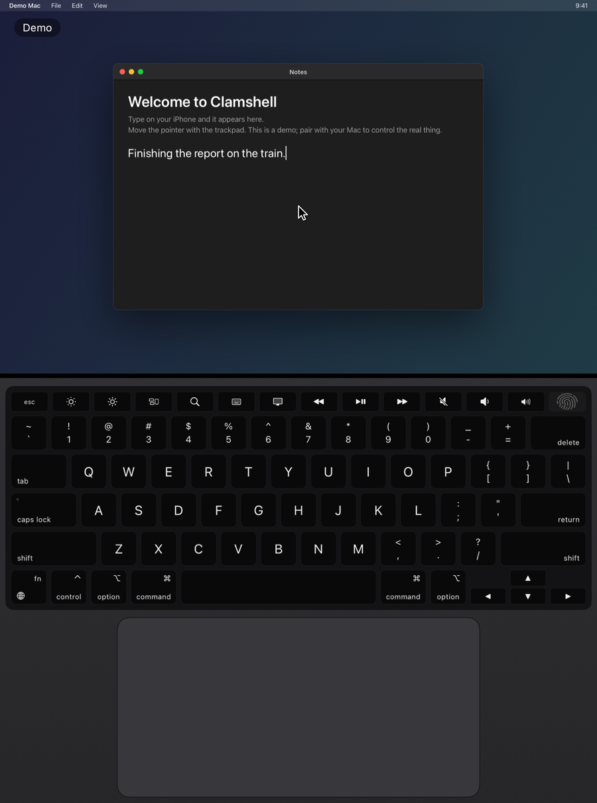
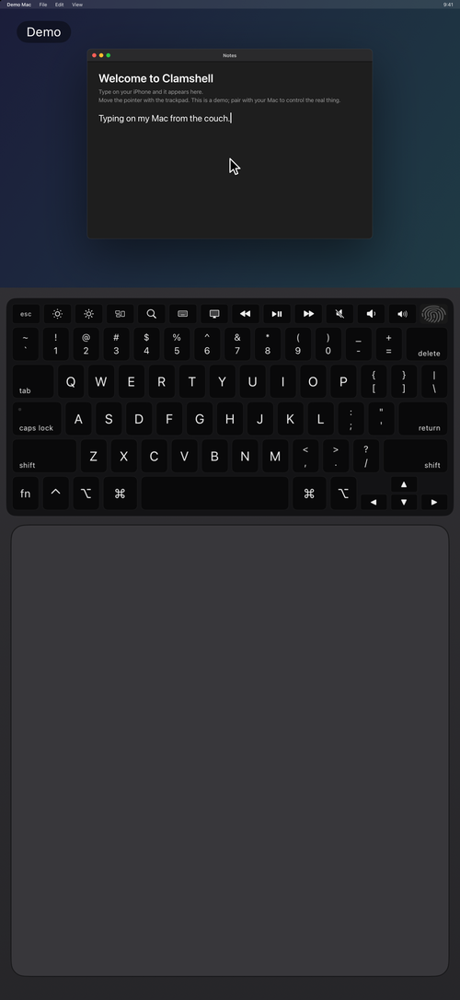

# Clamshell

Clamshell turns an iPhone into a remote for your own Mac. On a foldable iPhone held half open like a small laptop, the Mac's screen sits on the top half and a keyboard and trackpad sit on the bottom half, split on the fold. It also works on a regular iPhone and on a foldable opened flat.

It has two parts:

- **Clamshell** (on the App Store as Clamshell Remote), the iPhone app.
- **Clamshell Host**, a small menu bar app for the Mac. It streams the screen and plays your touches and typing on the Mac.

<p>
  
  &nbsp;
  
</p>

## Requirements

- iPhone on iOS 18 or later.
- Mac on macOS 14 (Sonoma) or later.
- Both on the same Wi-Fi, or both on the same VPN (for example Tailscale).

## Install

**iPhone:** [Clamshell Remote on the App Store](https://apps.apple.com/app/id6833036197).

**Mac:**

1. Download `Clamshell-Host-<version>.zip` from this repository's [Releases](https://github.com/TheRealJadenKwek/clamshell/releases) page and unzip it. The app is signed with a Developer ID and notarized by Apple. Each release lists the zip's SHA-256 checksum.
2. Move `Clamshell Host.app` to Applications and open it. It lives in the menu bar (a laptop icon), with no Dock icon. If the menu bar is too full to show it, open the app again and the panel opens in a window.
3. In the panel, click **Allow** next to each permission:
   - **Screen Recording**, to show the Mac's screen. After allowing it, quit and reopen Clamshell Host.
   - **Accessibility**, to use the keyboard and trackpad.
4. Open Clamshell on the iPhone and tap **Scan the code**. In the panel on the Mac, click **Show pairing code** and scan the QR code. You only do this once. (Or use **Copy pairing link** on the Mac and **Paste pairing link** on the iPhone.)

The first time it runs, Clamshell Host adds itself to Login Items so the Mac can be reached after a restart. Turn this off with **Open at login** in the panel; it is not turned back on.

## How it connects

The iPhone connects straight to the Mac over TCP port **47800**. There is no server in between.

- **Same Wi-Fi:** the iPhone finds the Mac by Bonjour (`_clamshell._tcp`) or by its local name and addresses.
- **From anywhere:** turn on Tailscale, or another VPN that puts both devices on one network, on the iPhone and the Mac. The pairing code carries the Mac's Bonjour name and its current addresses, Tailscale addresses first. If the Mac's addresses change for good, scan the code again.
- The iPhone tries every address at once and keeps the first that answers. If the link drops, it dials again on its own. If the macOS firewall is on, allow incoming connections for Clamshell Host.

## Features

**Holds**
- *Half open (foldable):* Mac screen above the fold, keyboard and trackpad below. If the phone cannot tell which half is on the table, the menu has **Flip top and bottom**.
- *Opened flat (foldable):* the picture follows how you hold the phone, including upside down, even with rotation lock on. The menu has **Turn upside down** for when it guesses wrong.
- *Regular iPhone, upright:* Mac screen on top, keyboard and trackpad below.
- *Landscape:* the picture fills the screen above a key bar. The bar's trackpad key switches to typing, with the picture on the left and a trackpad on the right.

**Keyboard** (menu: Keyboard)
- *iPhone keyboard* (the default): the iOS keyboard with autocorrect, predictions, swipe typing and dictation. A bar above it has esc, tab, control, option and command (tap to latch for the next key or click), arrow keys, a trackpad key that hides the keyboard and makes the whole bottom a trackpad, a key to switch to the Mac keyboard, and the menu. Autocorrect and auto-capitalize can be turned off. When a foldable is opened flat and held upside down, iOS will not turn its keyboard, so the app draws its own iPhone keyboard there, with autocorrect and suggestions.
- *Mac keyboard:* a full Mac layout drawn on the glass. Keys go down and up with your finger, so held keys and chords work. Tapping a modifier on its own latches it for the next key or click. The top row has brightness, Mission Control, Spotlight, a key to the iPhone keyboard, display size, media and volume keys; with fn they are F1 to F12, and fn turns the arrows into Home, End, Page Up and Page Down.
- A hardware keyboard connected to the iPhone also types on the Mac.
- **Type iPhone clipboard on the Mac** types the iPhone's clipboard text.

**Trackpad** (menu: Trackpad)
- One finger moves the pointer, faster movement goes further.
- Tap to click; two-finger tap to right-click; three-finger tap for a middle click.
- Two fingers scroll, with momentum.
- Three-finger swipe left or right changes spaces, up opens Mission Control, down shows the app's windows.
- *Press to click:* press harder to click and harder again for a Force Click (Look Up). The iPhone glass does not sense pressure, so it reads how much your fingertip flattens. Click pressure is Light, Medium or Firm. With Press to click off, hold still and then move to drag.
- Haptic clicks from the Taptic Engine (can be turned off).

**Mac screen**
- Touch the picture directly: tap to click, touch and hold to right-click, drag with one finger, scroll with two.
- Pinch to zoom; when zoomed in, the view follows the Mac's pointer.

**Display size** (menu: Display)
- Pick one of the Mac's own display sizes, the same choices as System Settings, from Larger Text to More Space, so the Mac's text is readable on a phone. The choice is kept for later connections. The Mac goes back to its own setting a few seconds after the iPhone disconnects, and also if Clamshell Host quits.

**Sound** (menu: Mac sound)
- The Mac's sound plays on the iPhone. On by default.

**Other**
- Video is HEVC at up to 60 frames per second. *Data saver* lowers the resolution and bit rate and turns sound off.
- The Mac's display stays awake while a phone is connected. If the display was asleep when the phone connected, it goes back to sleep half a minute after the phone leaves, unless someone used the Mac's own keyboard or mouse in the meantime. To keep it on instead: `defaults write com.jadenkwek.clamshell.host sleepDisplayAfterPhone -bool false`.
- **Reconnect** and **Forget this Mac** are in the menu.

## Security

The pairing code (the QR code, or the copied pairing link) contains a 32-byte random key. **Whoever has that key can see your Mac's screen and fully control its keyboard and pointer.** It is the only credential: there is no account or password besides it. Treat it like a password: do not share or post a picture of the QR code, and do not paste the link anywhere but your iPhone.

- The key is made on the Mac and kept in your login Keychain, as the item `com.jadenkwek.clamshell.host.pairing`, which only Clamshell Host can read without asking you. Hosts before 1.0 kept it in `~/Library/Application Support/Clamshell/pairing.key`. At launch the host reads the Keychain first. If the Keychain has no key yet and that file exists, the host stores the file's key in the Keychain, checks that it reads back, and deletes the file, so a paired iPhone keeps working; if the Keychain already has a key, that key is used and a leftover file is deleted. If the Keychain cannot be read or cannot store the key, the host does not listen and the panel says so; it never falls back to a file and never makes a new key on its own after such an error. On the iPhone the key is kept in the Keychain, on that device only.
- The panel shows the QR code only after you click **Show pairing code**, and hides it again after a minute or when the panel closes. **Copy pairing link** marks the copied link as concealed, so clipboard managers that honor that skip it, and clears it from the clipboard after a minute unless something else was copied since.
- The key never leaves your devices. It is never sent over the network: both sides prove they hold it in the TLS handshake.
- Every connection is encrypted and authenticated with TLS 1.2 using the key as a pre-shared key. Current builds use `TLS_ECDHE_PSK_WITH_CHACHA20_POLY1305_SHA256`, which adds a fresh key exchange to every session (forward secrecy): someone who records the traffic and later gets the key still cannot decrypt it. When one side is an older build that offers only `TLS_PSK_WITH_AES_128_GCM_SHA256`, the two connect with that suite, which has no forward secrecy; update both apps to avoid it. A device without the key cannot connect.
- **Disconnect** in the Mac panel ends the session and pauses connections: the Mac refuses every iPhone, paired or not, until you click **Resume**, or quit and reopen Clamshell Host.
- **New key** in the Mac panel makes a new key and revokes every paired iPhone at once: each is disconnected and stops working until it scans the new code. On the iPhone, **Forget this Mac** deletes the stored key.
- A paired iPhone controls the Mac exactly as a keyboard and trackpad plugged into it would. That includes the lock screen: while Clamshell Host is running, the iPhone can type there, a password included.
- The Mac limits what an iPhone can send (64 KB per message, about a megabyte of text waiting to be typed, pointer and scroll values that make sense), so a malformed message cannot crash or stall it.
- At most 8 connections may be part way through connecting, for 5 seconds each; when another arrives, the one that has waited longest is dropped. Someone flooding the local network with connections can delay or block a phone from connecting while the flood lasts, but cannot affect a phone that is already connected, and gains nothing without the key.
- The Mac only listens while Clamshell Host is running. Quit it from the panel to close the port.

See [SECURITY.md](SECURITY.md) to report a vulnerability.

## Privacy

Clamshell has no accounts, no analytics, no ads and no servers. Neither app makes any network connection except the direct one between your iPhone and your Mac. The iPhone uses the camera only to scan the pairing code. Clamshell Host keeps a log of connections, display changes and the phone's layout in `~/Library/Logs/Clamshell/host.log` on the Mac; it never contains the key or what you type. Full policy: [PRIVACY.md](PRIVACY.md).

## Building from source

You need Xcode (with the iOS 18 and macOS 14 SDKs or later) and [XcodeGen](https://github.com/yonaskolb/XcodeGen).

```sh
brew install xcodegen
xcodegen generate          # writes Clamshell.xcodeproj from project.yml
open Clamshell.xcodeproj
```

Schemes:

- `Clamshell`: the iPhone app. Its test action runs `ClamshellUITests`.
- `ClamshellHost`: the Mac host.

**To build your own copy**, change these to your own Apple team and identifiers:

- `DEVELOPMENT_TEAM`, `bundleIdPrefix` and every `PRODUCT_BUNDLE_IDENTIFIER` in `project.yml` (`com.jadenkwek.clamshell*`).
- `fastlane/Appfile`, `APP_ID` in `fastlane/Fastfile` and `BUNDLE` in `tools/testflight.py`, if you use them.
- `TEAM_ID` at the top of `tools/release-host.sh` (or set `CLAMSHELL_TEAM_ID`). The script finds your one "Developer ID Application" identity for that team in the keychain; if you have several, set `CLAMSHELL_SIGN_IDENTITY` to the SHA-1 of the one to use.

Then run `xcodegen generate` again.

### UI tests

The UI tests drive the real keyboard and trackpad against a test host that only logs what it receives. Run the test host on a spare port so it does not clash with a real host on 47800:

```sh
# Build the host (Debug) and start it in test mode.
xcodebuild -project Clamshell.xcodeproj -scheme ClamshellHost -configuration Debug \
  -derivedDataPath build/dd build
"build/dd/Build/Products/Debug/Clamshell Host.app/Contents/MacOS/Clamshell Host" \
  --dry-run --test-pattern --port 47801 --print-link 2> build/test-host.log &
```

- `--dry-run` and `--test-pattern` each start the same full test host, alone or together: it never posts real input, only pretends to change the display size, never wakes the display or keeps it awake, never captures the screen or sound, and draws a test picture showing the last input.
- `--print-link` prints the pairing link on standard output, on a test host only; a normal host ignores it. The log goes to standard error.
- A test host shows no menu bar icon and writes no log file. It never reads or writes the real pairing key: it makes a new throwaway key each time it starts.

Then run the tests on a simulator, passing the link and the log through `TEST_RUNNER_` variables:

```sh
TEST_RUNNER_PAIRING_URL='clamshell://pair?...' \
TEST_RUNNER_HOST_LOG="$PWD/build/test-host.log" \
xcodebuild test -project Clamshell.xcodeproj -scheme Clamshell \
  -destination 'platform=iOS Simulator,name=iPhone 16 Pro'
```

The tests launch the app with `-pairingURL <link> -noBonjour YES`, so it dials only the addresses in the link and never finds a real host on the network by Bonjour. Set `TEST_RUNNER_FORCE_HINGE=half` to lay the app out as if half open.

### Releasing

- **Mac host:** `tools/release-host.sh [version]` builds `ClamshellHost` in Release, signs it with a Developer ID and hardened runtime, notarizes and staples it, and leaves `build/release/Clamshell-Host-<version>.zip` and its `.sha256`. The version defaults to `MARKETING_VERSION` in `project.yml`; the build number is the UTC time (`YYYYMMDDHHMM`). It refuses to run with uncommitted changes unless `ALLOW_DIRTY=1`. `tools/release-host.sh --identity` only shows which signing identity it would use.
- **iPhone app:** `cd fastlane && fastlane beta` builds and uploads to TestFlight; `tools/testflight.py status` shows the builds.

Both read an App Store Connect API key from `ASC_KEY_ID`, `ASC_ISSUER_ID` and `ASC_KEY_PATH` in the environment, or from `~/.config/clamshell/asc.env` (plain `NAME=value` lines). Keep the key and that file out of the repository.

## Project layout

```
iOS/        the iPhone app: session screen, keyboards, trackpad, video, sound, pairing
Host/       the Mac host: menu bar panel, server, screen and sound capture, video encoder, input
Shared/     the wire protocol and the encrypted channel, used by both
UITests/    UI tests for the iPhone app against a test host
scripts/    make_icon.swift, which draws the app icons
tools/      release-host.sh, TestFlight and App Store Connect helpers
fastlane/   iPhone build and TestFlight upload
project.yml the XcodeGen project
```

## License

MIT. See [LICENSE](LICENSE).
